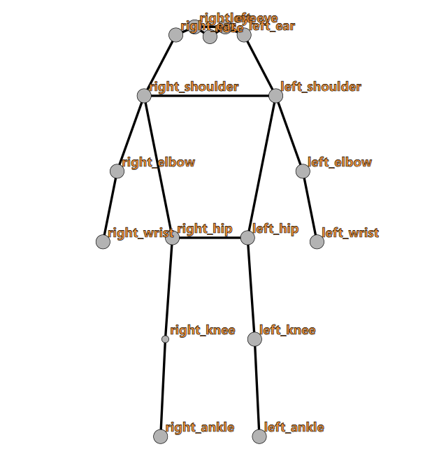
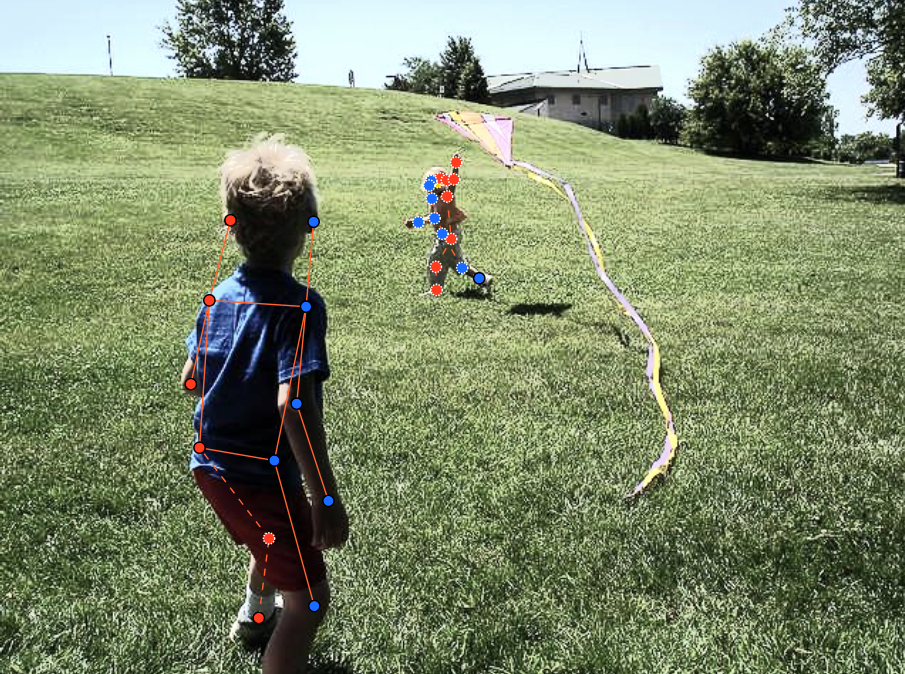
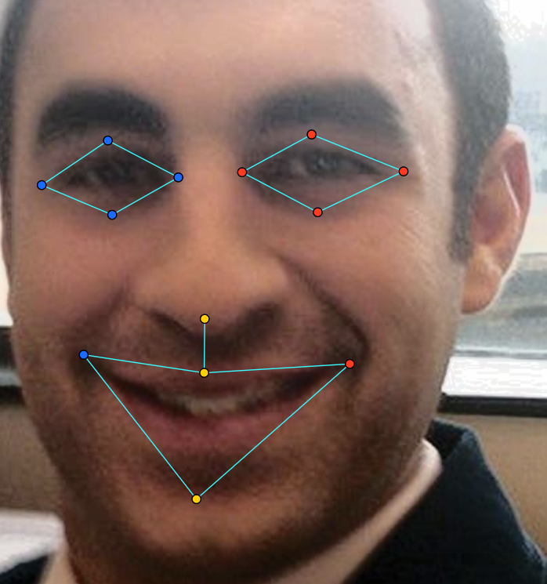
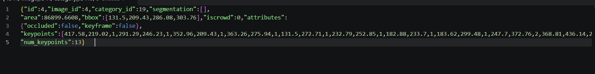

# Báo cáo cá nhân — HoVaTen-MSSV

Đổi tên file theo quy tắc `MSSV_HoTen.md`. Ví dụ: `20241234_NguyenVanAn.md`.

Dữ liệu: 12 ảnh người COCO val2017 (Lin et al., 2014) và 8 ảnh chân dung Wikimedia Commons, chỉ dùng trong lớp.

## 0. Thông tin học viên

- Họ tên:Nguyễn Viết Minh
- MSSV:2A202604043
- Email:
- Link repository:https://github.com/minh23012003/K5-L2-2A202604043-NguyenVietMinh-KeypointPose-Student
- Phiên bản CVAT (Help → About):
- Máy: hệ điều hành ___ · RAM ___ GB · chạy CVAT chế độ đầy đủ / lite
- Bộ ảnh (`src/exports/assignment.json` do `lab.py setup` tạo): có 
- Giờ bắt đầu:
- Giờ kết thúc:

## 1. Kiểm tra label (CP0)

| Label | Kiểu | Số điểm | Tên điểm đúng bảng của lab? | Đúng thứ tự? | Số cạnh |
|---|---|---:|---|---|---:|
| `person` |Skeleton | 17	| | | |
| `face` | Skeleton| 13	| | | |

Mẫu `person` dựng theo người quay mặt về camera (các điểm `left_*` nằm bên phải khung mẫu)? Có 

Cách đổi cờ `occluded` / `outside` cho **một điểm** trên phiên bản CVAT này (một câu):
- Rê chuột vào đúng điểm cần đổi rồi nhấn Q để đánh occluded (v = 1) hoặc O để đánh outside (v = 0)
...

## 2. Số lượng đã gán và thời gian (CP1, CP2)

| Nhóm ảnh | Số ảnh | Số skeleton đã gán | Số người dưới 60 px (không gán) | Số poster / gương / màn hình bỏ qua | Thời gian (phút) |
             |---|---:|---:|---:|---:|---:|
| `easy`     | 5 | 5 | 1 | | |
| `occluded` | 3 | 6 |   | | |
| `back`     | 2 | 5 |   | | |
| `small`    | 1 | 2 |   | | |
| `crowd`    | 1 | 3 | 1 | | |
| `faces`    | 8 | 8 |   | | |

- Số ảnh người đã xong ở mốc phút 105: ___ / 10
- Thời gian thực tế (phút): CP1 ___ · CP2 ___ · CP3 ___
- Ảnh tốn thời gian nhất là ảnh nào, vì sao?
Ảnh : 000000183176.jpg
- vì người phụ nữ đằng sau nhiều chi tiết bị che
...

## 3. Bảng ca khó (CP1, CP2)

Mỗi điểm bạn phân vân một dòng, nhất là phân vân giữa `v = 1` và `v = 0`, hoặc không chắc hướng người.

| Ảnh | Người / mặt | Điểm | Cờ đã chọn | Phân vân giữa | Lý do chọn |
|---|---|---|---:|---|---|
| 000000183176.jpg| người | left_shoulder,right_shoulderleft_eye,left_hip,right_hip| 1 | v=1 và v=0 | chọn 1 vì mặc dù bị che nhưng vẫn có thể ước lượng được|
| face_405456| face| LEFT_EYE_, RIGHT_EYE_| | v=1 / v=0| Tròng kính râm che hết mí và tròng mắt| 
| 000000521817.jpg	| person|left_knee | 0	|v=1 / v=0 |Điểm nằm ngoài khung ảnh tại  |

## 4. Bảng tự review (CP3)

Đi từ ảnh cuối về ảnh đầu. 5 ảnh người (ít nhất 2 ảnh `back` hoặc `crowd`) và 3 ảnh mặt. Ít nhất 8 dòng, kể cả dòng `ok`. Ghi lỗi trước, sửa sau.

Mã lỗi dùng đúng một trong: `lr_swap`, `vis_flag`, `position`, `missing`, `extra`, `ok`.

| Ảnh | Người / mặt | Điểm | Mã lỗi | Ghi chú | Đã sửa? |
|---|---|---|---|---|---|
| 000000521817.jpg| person|left_knee |vis_flag|v = 2 nhưng nằm ngoài ảnh tại | Có|
|000000461002.jpg	|person |left_knee, left_ankle |lr_swap |Cặp knee/ankle nằm ngược phía so với các cặp còn lại, kiểm tra xem có phải chân bắt chéo thật | |
| 000000326480.jpg	| person| left_eye| lr_swap	|Cặp eye ngược phía; ảnh crowd nên kiểm tra kỹ từng người | |
|000000123544.jpg	 | person   | left_hip, left_knee| lr_swap|Cặp hip/knee ngược phía, kiểm tra lại trái/phải theo người | |
|000000326480.jpg	 |person |toàn bộ skeleton | extra| Người cao khoảng 42 px (< 60 px), xóa nếu đúng là dưới ngưỡng| |
| 000000189365.jpg	|person	 |left_wrist | lr_swap	| Cặp wrist nằm ngược phía so với các cặp còn lại| |
|face_405456 |face | LEFT_EYE, RIGHT_EYE |vis_flag | Kính râm che tròng mắt, cờ đang để v = 2, cần đổi sang Q hoặc O| |
|face_405456| face| LIP_LOWER|position	 |Điểm nằm trên micro/cằm, kéo về môi dưới | |

Tổng hợp số lỗi theo mã:

| `lr_swap` | `vis_flag` | `position` | `missing` | `extra` | `ok` |
|---:|---:|---:|---:|---:|---:|
| 4| 2| 1| 0|1 |0 |

Điểm còn phân vân giữa `v = 1` và `v = 0` (ghi cả hai lựa chọn và lý do chọn):

- 000000521817.jpg, left_knee: phân vân giữa v = 1 (Q) và v = 0 (O). Đã chọn v = 0 vì điểm nằm ngoài khung ảnh tại (100, 469).
- face_405456, mắt (LEFT_EYE, RIGHT_EYE): phân vân giữa v = 1 (Q) và v = 0 (O) vì tròng kính râm che hết mí và tròng mắt. Lựa chọn cuối cùng: v = 1 nếu ước lượng được vị trí từ gọng kính, v = 0 nếu không. Ghi rõ lựa chọn bạn đã dùng.

## 5. Kiểm file xuất và kết quả tự kiểm (CP4)

Tự kiểm tay trong file JSON:

| File | Người / mặt kiểm (ảnh, thứ tự) | Số phần tử `keypoints` | Điểm `outside` ra `v = 0`, `occluded` ra `v = 1`? | `num_keypoints` khớp? |
|---|---|---:|---|---|
| `NguyenVietMinh_persons.zip` |000000521817.jpg, skeleton #1 | 51	|Không: left_knee vẫn v = 1, chưa phải v = 0 | Có (16)|
| `NguyenVietMinh_faces.zip` | face_405456|39	 | Có: 8 điểm mắt v = 1 . Không có điểm v = 0 nên không có outside.|Có (13) |

Sau khi xuất, CVAT ghi `occluded` thành `v = ___` và `outside` thành `v = ___`. Tọa độ của điểm `outside` trong file là `0, 0` hay tọa độ cũ? ___
- Sau khi xuất, CVAT ghi occluded thành v = 1 và outside thành v = 0. Điều này đã được xác nhận trong file person: các điểm đánh Q có v = 1 và các điểm có v = 0 tồn tại. Tuy nhiên, với left_knee của 000000521817.jpg, hiện vẫn là v = 1, chưa phải v = 0. Nếu bạn đã sửa thành O trên CVAT rồi xuất lại, ô này sẽ đúng.
Hai job đã chuyển sang completed trên CVAT? Có / Không - > có, nhấn thủ công

Dán phần **TÓM TẮT** in ra từ `src/check_submission.py`:

```text
NguyenVietMinh_persons.zip: 12 ảnh · 21 skeleton person · 51 số/annotation
  v=2: 212 (59%) · v=1: 95 (27%) · v=0: 50 (14%) · num_keypoints TB 14.6
  [LỖI] 0 · [CẢNH BÁO] 7 · Kết quả: ĐẠT

NguyenVietMinh_faces.zip: 8 ảnh · 8 skeleton face · 39 số/annotation
  v=2: 91 (88%) · v=1: 13 (12%) · v=0: 0 (0%) · num_keypoints TB 13.0
  [LỖI] 0 · [CẢNH BÁO] 0 · Kết quả: ĐẠT
```

Các `[CẢNH BÁO]` còn giữ nguyên và lý do:

...

## 6. Ảnh chụp màn hình

1. Label `person` trong label constructor (đủ 17 điểm có tên):

   

2. Một người quay lưng đã gán, cờ đã đặt:

   

3. Một khuôn mặt đã gán 13 điểm, phóng to vùng mắt:

   

4. Một đoạn JSON xuất của một người:

   

Nguồn ảnh: COCO val2017 / Wikimedia Commons.

## 7. Tự đánh giá

1. Lỗi bạn mắc nhiều nhất hôm nay, và cách bạn sẽ tránh ở dự án thật:

- đặt cờ v chưa nhất quán và chỉnh lệch trái/phải. Sẽ cẩn thận kiểm tra trước khi submit
 

2. Một quy tắc bạn đề xuất thêm vào guideline (kèm ảnh ví dụ nếu có):

   ...

3. Nhãn của bạn đi vào model ở đâu? Chọn một lỗi bạn đã sửa và nói nó sẽ làm model học sai thế nào (heatmap, trọng số trong loss, hay bước lật ảnh):

- Nhãn đi vào model qua heatmap (bản đồ nhiệt), là mục tiêu để model học. Ví dụ: nếu left_knee bị đặt v = 2 trong khi thực ra nằm ngoài ảnh, model sẽ học sai vị trí đó. Nếu lr_swap không sửa, khi lật ảnh model sẽ học nhầm tay trái và tay phải

## 8. Khó khăn và lỗi kỹ thuật

...

## Bonus (nếu làm)

### B1 — 3 ảnh người khó thêm

| Ảnh | Số skeleton | Số người dưới 60 px | Ca khó nhất |
|---|---:|---:|---|
| | | | |
| | | | |
| | | | |

Kết quả `src/check_submission.py` cho `HoVaTen_bonus_persons.zip`:

```text
(dán ở đây)
```

### B2 — 5 ảnh khuôn mặt đen trắng / hồng ngoại

Ảnh không màu khó hơn ở điểm nào? Kính râm trên ảnh hồng ngoại có còn là `v = 1` không?

...

### B3 — Model so với nhãn của tôi (không tính điểm)

- Demo đã dùng:
- Ảnh đã thử:

1. Model có trả điểm cho khớp bị che, hay khớp ngoài ảnh không? Confidence ở các điểm đó thế nào?

   ...

2. Với người quay lưng, model có đổi trái/phải không?

   ...

3. Bộ điểm của model có giống 17 điểm COCO không?

   ...

## 9. Tài liệu tham khảo và công cụ AI đã dùng

...
